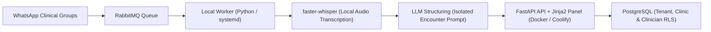

# Skorp Clinic

[Português](#versao-em-portugues) | [English](#english-version)

> **Aviso de código privado:** Este repositório é a vitrine pública de arquitetura do Skorp Clinic (módulo de evoluções clínicas). O código-fonte é privado por ser um produto em piloto. Demonstração ao vivo sob pedido: [antonymsandrade@gmail.com](mailto:antonymsandrade@gmail.com) ou [LinkedIn](https://www.linkedin.com/in/antonyandrade01/).
>
> **Private repository notice:** This repository is the public architecture showcase for Skorp Clinic (clinical progress notes service). Source code is private while the product is in a pilot. Live demos are available on request: [antonymsandrade@gmail.com](mailto:antonymsandrade@gmail.com) or [LinkedIn](https://www.linkedin.com/in/antonyandrade01/).

**No ar / Live:** [evolucao.antonyandrade.com.br](https://evolucao.antonyandrade.com.br) (app no ar; pede login / live app; requires login). Acesso de demonstração sob pedido / Demo access on request.

---

## Arquitetura / Architecture

---

## Versão em Português

### Problema que resolve

Profissionais de saúde, como fonoaudiólogos, gastam tempo fora do expediente escrevendo evoluções clínicas a partir de anotações soltas ou áudios gravados após o atendimento. Ferramentas genéricas de IA costumam misturar sessões antigas com o relato do dia, inventar datas ou horários e não isolam prontuários por clínica e por profissional.

O Skorp Clinic recebe o áudio ou texto enviado em grupo de WhatsApp, transcreve localmente sem custo por minuto, estrutura a evolução do atendimento de forma isolada e deixa o registro pronto para o profissional revisar e aprovar no painel web.

### Decisões técnicas e trade-offs

#### Relato do dia isolado do histórico do paciente

Problema: quando o modelo recebe evoluções antigas junto com o áudio do dia, ele tende a copiar condutas passadas para a sessão atual.

O que foi feito: o prompt de estruturação recebe apenas a transcrição do dia, o modelo da especialidade, a data e o nome do profissional. Um pós-processamento descarta nomes, convênios ou horários que o modelo citar sem aparecerem no relato original.

Trade-off: o sistema não preenche lacunas com dados de atendimentos passados, mas mantém a evolução fiel ao que aconteceu naquele dia.

#### Vínculo exato de paciente e proteção contra exclusão

Problema: associar um relato ao paciente errado por semelhança de nome traz risco clínico e jurídico.

O que foi feito: o vínculo automático só acontece por correspondência exata (sem acento e sem diferença de maiúsculas) com o nome completo ou apelido cadastrado. Nomes parecidos criam um registro provisório e sugerem candidatos para confirmação humana. O papel de banco usado pela API não tem permissão de `DELETE` nas tabelas clínicas; correções e mesclas apenas inativam o cadastro antigo.

Trade-off: o profissional precisa confirmar um apelido novo na primeira vez, mas evita gravar uma evolução no prontuário errado.

#### Transcrição local com filtro de silêncio

O worker roda `faster-whisper` localmente em CPU com detecção de voz (Silero VAD) e limpeza determinística de frases fantasma comuns quando há trechos longos de silêncio.

Trade-off: transcrever em CPU leva mais tempo do que APIs pagas com GPU, mas mantém áudios clínicos dentro do próprio servidor e sem custo por minuto.

#### Isolamento em três níveis no PostgreSQL (RLS)

As políticas de RLS isolam os dados por tenant, clínica e profissional atribuído ao paciente. Pedidos feitos à IA sobre o prontuário ficam visíveis apenas para quem perguntou e somente enquanto mantiver acesso àquele paciente.

### O que está no ar

- Em piloto inicial com profissionais de saúde em [evolucao.antonyandrade.com.br](https://evolucao.antonyandrade.com.br).
- Recebimento de áudios e textos do WhatsApp via RabbitMQ e transcrição local com `faster-whisper`.
- Estruturação isolada da evolução clínica por especialidade, match exato de paciente e painel web em FastAPI e Jinja2 para revisão e aprovação.

---

## English Version

### Problem it solves

Clinicians such as speech therapists spend time after hours writing progress notes from scattered notes or voice memos recorded right after appointments. Generic AI tools often mix old chart history into today's session note, invent dates or times, and lack strict clinic- and clinician-level access boundaries.

Skorp Clinic receives voice or text notes sent in WhatsApp groups, transcribes audio locally without per-minute API fees, structures each session note in isolation, and prepares it for clinician review and approval in a web panel.

### Technical decisions and trade-offs

#### Session note structuring isolated from patient history

Problem: when an LLM sees past session notes alongside today's audio, it tends to carry old procedures into today's encounter.

What was done: the structuring prompt receives only today's transcript, the specialty template, the date, and the clinician's name. Post-processing strips any patient name, insurer, or timestamp not present in the raw input.

Trade-off: the draft does not auto-fill gaps from previous visits, but keeps every note anchored strictly to what happened in that session.

#### Exact patient matching and soft-inactivation only

Problem: linking a note to the wrong patient based on fuzzy name similarity creates clinical and legal risk.

What was done: automatic linking runs only on exact normalized matches (case- and accent-insensitive) against a registered full name or alias. Similar names create a provisional entry and suggest candidates for human confirmation. The API database role has no `DELETE` privilege on clinical tables, so corrections and merges only mark old entries inactive.

Trade-off: clinicians have to confirm a new nickname once, but the system avoids filing a note under the wrong patient.

#### Local audio transcription with silence filtering

The worker runs `faster-whisper` locally on CPU with Silero VAD and deterministic cleanup of common phantom phrases generated during silent stretches.

Trade-off: CPU transcription is slower than paid cloud GPU APIs, but keeps clinical audio on self-hosted hardware with zero variable cost.

#### Three-level PostgreSQL RLS isolation

RLS policies isolate records by tenant, clinic, and assigned clinician. Chart queries stay visible only to the clinician who asked and only while they retain access to that patient.

### What is live

- In an initial pilot with health professionals at [evolucao.antonyandrade.com.br](https://evolucao.antonyandrade.com.br).
- WhatsApp voice and text intake over RabbitMQ and local `faster-whisper` transcription.
- Isolated clinical structuring by specialty template, exact patient matching, and a FastAPI/Jinja2 web panel for review and approval.
