# Skorp Clinic

[Português](#versao-em-portugues) | [English](#english-version)

> **Aviso de código privado:** Este repositório é a vitrine pública de arquitetura do Skorp Clinic (módulo de evoluções clínicas). O código-fonte é privado por ser um produto em desenvolvimento e homologação. Demonstração ao vivo sob pedido: [antonymsandrade@gmail.com](mailto:antonymsandrade@gmail.com) ou [LinkedIn](https://www.linkedin.com/in/antonyandrade01/).
>
> **Private repository notice:** This repository is the public architecture showcase for Skorp Clinic (clinical progress notes service). Source code is private while the product is in testing and development. Live demos are available on request: [antonymsandrade@gmail.com](mailto:antonymsandrade@gmail.com) or [LinkedIn](https://www.linkedin.com/in/antonyandrade01/).

---

## Arquitetura / Architecture

```mermaid
flowchart LR
    WA["WhatsApp Clinical Groups"] --> RMQ["RabbitMQ (evolucao-fono.whatsapp)"]
    RMQ --> WRK["Local Worker (systemd, Python)"]
    WRK --> WH["faster-whisper (Local pt-BR + Silero VAD + Anti-Hallucination)"]
    WH --> LLM["Cascaded LLM Runner (No Tools, Isolated Prompt)"]
    LLM --> API["FastAPI API + Jinja2 Panel (Docker / Coolify)"]
    API --> PG["PostgreSQL 18 (Multi-Tenant + Clinic + Clinician RLS)"]
    PG --> TRG["SQL Trigger (evo_gatilho_consolidacao)"]
    TRG --> Q["SQL Queue (FOR UPDATE SKIP LOCKED)"]
    Q --> WRK
```

---

## Versão em Português

### Problema que resolve

Profissionais de saúde (como fonoaudiólogos e equipes multidisciplinares) gastam tempo fora do expediente redigindo evoluções clínicas a partir de anotações soltas ou áudios gravados logo após o atendimento. Ferramentas genéricas de IA misturam histórico antigo com o relato do dia, inventam datas ou horários e expõem prontuários sem controle estrito de acesso por clínica e por profissional.

O Skorp Clinic recebe o áudio ou texto enviado pelo profissional em grupo de WhatsApp, transcreve localmente sem custo por minuto, estrutura a evolução clínica de forma isolada e só libera consolidação de histórico, alertas clínicos e perguntas ao prontuário depois que o profissional revisa e aprova a evolução.

### Números reais

- Projeto recente em homologação inicial com uso real por profissional de saúde: 2 usuários, 3 profissionais cadastrados e 10 evoluções registradas no banco.
- Validado por 103 testes automatizados em Pytest cobrindo isolamento RLS, match exato de pacientes, filtro anti-alucinação, segurança de acesso e fila da camada de consolidação.
- Estruturado em 5 migrations SQL no PostgreSQL 18 com papéis separados (`evolucao_owner` para DDL e `evolucao_app` para execução, sem permissão de `DELETE` em dados clínicos).

### Decisões técnicas e trade-offs

#### Separação rígida entre Camada 1 (ato clínico) e Camada 2 (histórico)

Na Camada 1, o prompt de estruturação recebe apenas o relato do dia, a skill da especialidade, a data e o nome do profissional. Nenhum histórico anterior do paciente entra no contexto. Essa restrição impede "alucinação regressiva", onde o modelo copia condutas de sessões passadas para o atendimento atual. A Camada 2 (histórico consolidado, card pré-atendimento, alertas clínicos, relatório circunstanciado e perguntas ao prontuário) lê exclusivamente evoluções com status `concluida`.

Trade-off: a estruturação inicial não completa lacunas automaticamente com dados de sessões antigas, mas garante fidelidade documental ao que realmente aconteceu no dia. Além disso, o código descarta nome, convênio e horário que o modelo citar sem respaldo no relato original, e nas perguntas ao prontuário toda afirmação precisa apontar a data real de uma sessão concluída.

#### Match exato de paciente e proteção contra falsos vínculos

Ao receber um relato, o sistema vincula automaticamente o paciente apenas por correspondência exata (sem acento e sem diferença de maiúsculas) com nome completo ou apelido cadastrado. Nomes parecidos nunca são vinculados de forma automática: o relato gera um cadastro provisório e devolve uma sugestão para o profissional confirmar. O papel de banco da API não tem permissão `DELETE` em registros clínicos; substituições e mesclas apenas inativam o cadastro antigo.

Trade-off: gera um passo extra de confirmação quando o profissional dita um apelido novo, mas elimina o risco clínico e jurídico de gravar uma evolução no prontuário da pessoa errada.

#### Transcrição local com filtros anti-alucinação e fila transacional no PostgreSQL

O worker roda `faster-whisper` 1.2.1 localmente em CPU (`int8`, idioma fixo `pt`, `temperature=0.0`, `condition_on_previous_text=False`, Silero VAD e `hallucination_silence_threshold=2.0`), seguido de limpeza determinística de frases fantasma típicas do Whisper. Na Camada 2, um trigger SQL (`evo_gatilho_consolidacao`, `SECURITY DEFINER` com `search_path` travado) marca o paciente para consolidação sempre que uma evolução vira `concluida` ou muda de texto/paciente, e o worker consome a fila diretamente no PostgreSQL usando `FOR UPDATE SKIP LOCKED` com controle de lease e prioridade (relato do dia > pergunta/relatório > consolidação).

Trade-off: transcrição em CPU local leva mais tempo do que APIs pagas em nuvem, mas mantém áudios clínicos dentro do servidor próprio e sem custo variável por token ou minuto. Usar fila em tabela SQL com `SKIP LOCKED` evita subir um segundo broker para tarefas de consolidação, mantendo a transação do trigger e a enfileiração atômicas.

#### Isolamento em três níveis com PostgreSQL RLS

As políticas de RLS isolam dados por `tenant_id`, `clinica_id` e profissional atribuído ao paciente. Perguntas feitas ao prontuário (`pedidos_ia`) ficam visíveis apenas para quem perguntou e somente enquanto o usuário mantiver acesso àquele paciente.

### Em produção vs. em teste

Em produção (uso inicial em homologação):
- Camada 1 ativa no Coolify + Cloudflare Tunnel: recebimento via RabbitMQ/WhatsApp, transcrição local com faster-whisper, estruturação isolada por skill clínica, match exato de paciente e revisão no painel web FastAPI/Jinja2.

Em teste (pronta em branch local, aguardando revisão final antes de publicação):
- Camada 2 completa: consolidação assíncrona de histórico por trigger SQL, card "Antes do atendimento", alertas clínicos, minuta de relatório circunstanciado e chat com perguntas ancoradas em datas de sessões concluídas.
- Integração futura com módulo de recepção clínica e agenda (planejado para compor a suíte Skorp Clinic).

---

## English Version

### Problem it solves

Clinicians such as speech therapists spend unpaid time after sessions writing progress notes from scattered jottings or voice memos. Generic AI tools mix old chart history into today's session note, invent dates or times, and lack strict clinic- and clinician-level access boundaries.

Skorp Clinic captures voice or text notes sent by clinicians in WhatsApp groups, transcribes audio locally without per-minute API fees, structures the session note in isolation, and only unlocks longitudinal summaries, clinical alerts, and chart Q&A after the clinician reviews and approves the note.

### Real numbers

- Early-stage product in live testing with a practicing clinician: 2 users, 3 registered clinicians, and 10 recorded progress notes.
- Covered by 103 automated Pytest tests spanning PostgreSQL RLS isolation, exact patient matching, Whisper hallucination filtering, panel access control, and Layer 2 queue mechanics.
- Built on 5 SQL migrations in PostgreSQL 18 with split database roles (`evolucao_owner` for DDL and `evolucao_app` for runtime, with `DELETE` revoked on clinical records).

### Technical decisions and trade-offs

#### Strict split between Layer 1 (clinical encounter) and Layer 2 (longitudinal memory)

Layer 1 structuring sends only today's note, the specialty skill prompt, the date, and the clinician's name to the LLM. Prior patient history never enters the prompt, preventing regressive hallucination where past sessions bleed into today's record. Layer 2 (consolidated history, pre-session summary card, clinical alerts, structured reports, and chart Q&A) reads strictly from records marked `concluida`.

Trade-off: Layer 1 does not auto-fill gaps from previous visits, but guarantees every note reflects only what happened in that session. Post-processing strips any patient name, insurer, or timestamp not grounded in the raw input, and chart Q&A requires every claim to cite a real completed session date.

#### Exact patient matching and soft-inactivation only

Incoming notes link automatically only on exact normalized matches (case- and accent-insensitive) against a registered full name or alias. Similar names never auto-link; instead, the system creates a provisional record and suggests candidates for human confirmation. The runtime database role has no `DELETE` privilege on clinical tables, so merges and replacements only mark old entries inactive.

Trade-off: clinicians must confirm new nicknames once, but the system eliminates the clinical risk of filing a note under the wrong patient.

#### Local anti-hallucination transcription and PostgreSQL `SKIP LOCKED` queue

The systemd worker runs `faster-whisper` 1.2.1 on CPU (`int8`, fixed `pt` language, `temperature=0.0`, `condition_on_previous_text=False`, Silero VAD, and `hallucination_silence_threshold=2.0`), followed by deterministic cleanup of common Whisper phantom phrases. In Layer 2, a `SECURITY DEFINER` SQL trigger (`evo_gatilho_consolidacao` with pinned `search_path`) marks patients for reconsolidation whenever a note transitions to `concluida` or changes content/patient, and the worker claims jobs via `FOR UPDATE SKIP LOCKED` with lease timeouts and priority ordering (daily notes > Q&A/reports > background consolidation).

Trade-off: CPU transcription is slower than cloud GPU APIs, but keeps clinical audio on self-hosted hardware at zero variable cost. Using PostgreSQL as the Layer 2 queue avoids running another broker while keeping trigger updates and queueing inside the same database transaction.

#### Three-level PostgreSQL RLS isolation

RLS policies enforce tenant, clinic, and assigned-clinician boundaries. Chart Q&A requests (`pedidos_ia`) are visible only to the clinician who asked and only while they retain access to that patient.

### Production vs. in testing

In production (initial clinical testing):
- Layer 1 live on Coolify + Cloudflare Tunnel: WhatsApp intake via RabbitMQ, local faster-whisper transcription, isolated clinical structuring by specialty skill, exact patient matching, and review in the FastAPI/Jinja2 web panel.

In testing (complete on a local feature branch, pending final review before release):
- Full Layer 2: trigger-driven async history consolidation, pre-session summary card, clinical alerts, draft clinical reports, and date-cited chart Q&A.
- Future reception and scheduling module planned to connect with this service.
